<!-- CYBER_PROFILE_START -->

<h3><code>shamil shiras A</code></h3>

 
 

<h3><code>shamilshiras@github ~ $ whoami</code></h3>

<table>
  <tr>
    <td valign="top" style="border: none; padding: 0;">
      
    </td>
    <td valign="top" style="border: none; padding: 0;">
      
    </td>
  </tr>
</table>

<!-- CYBER_PROFILE_END -->

 

---

## 👤 About Me
- 🎓 **Education:** B.Tech in **Computer Science and Design** (Class of 2026) at *Vimal Jyothi Engineering College, Chemperi*.
- 🎯 **Target Roles:** **Python Developer**, **Backend Software Engineer**, **Junior ML Engineer**.
- 💡 **Core Focus:** Building clean, scalable backend systems in **Django / REST APIs**, automated **Apache Airflow ETL pipelines**, and **NLP-powered machine learning** tools.
- 📍 **Location:** Kerala, India.

---

## 🛠️ Technical Skills

| Domain | Technologies & Frameworks |
| :--- | :--- |
| **Programming Languages** | `Python`, `JavaScript`, `SQL`, `HTML5`, `CSS3` |
| **Backend & APIs** | `Django`, `Django REST Framework (DRF)`, `Django ORM`, `REST APIs` |
| **Databases** | `MySQL`, `SQLite`, `Database Indexing & Query Optimization` |
| **AI & Machine Learning** | `NLP`, `IndicBERT / MuRIL`, `Scikit-learn`, `NumPy`, `Pandas` |
| **Data Pipelines & Tools** | `Apache Airflow (ETL)`, `Docker`, `Docker Compose`, `Git`, `GitHub`, `Postman` |
| **Frontend Integration** | `React.js`, `Chart.js` |
| **Core Computer Science** | `Object-Oriented Programming (OOP)`, `DSA Fundamentals`, `CRUD Architecture` |

---

## 🚀 Featured Projects

### 🛡️ 1. [Smart Shield — AI-Driven Detection of Cyberbullying in Regional Languages](https://github.com/Shamilshiras)
> **Stack:** *Python, Django, NLP, IndicBERT/MuRIL, REST APIs*
- Developed a real-time AI system detecting cyberbullying in regional (**Malayalam**) and code-mixed (**Manglish**) text.
- Leveraged a hybrid approach combining **NLP** and **IndicBERT / MuRIL** to analyze low-resource regional slang and intent.
- Provides real-time polite rephrasings to prevent harmful communication before transmission.
- Engineered a modular **Django backend** with feedback loops and Admin lexicon management.

### 📊 2. [SkillSight — Automated Job Market Pipeline & Dashboard](https://github.com/Shamilshiras)
> **Stack:** *Python, Apache Airflow, Pandas, Docker, MySQL, REST APIs*
- Built a fault-tolerant daily **ETL pipeline in Apache Airflow** with automated retries and fallback datasets.
- Processed and categorized keyword taxonomies across thousands of job postings using **Pandas** and regex.
- Optimized **MySQL database queries to under 1.5s** using precomputed aggregation tables and indexing.
- Containerized infrastructure with **Docker & Docker Compose** with REST APIs for analytics access.

### 💳 3. [SpendWise — Personal Expense Tracker Web App](https://github.com/Shamilshiras)
> **Stack:** *Python, Django, MySQL, JavaScript, Chart.js*
- Personal expense management application with full **CRUD operations**.
- Interactive dashboard visualizing daily, weekly, and monthly spending summaries via **Chart.js**.
- Implemented responsive category and date-range filtering, sorting, and pagination.

---

## 📜 Certifications
- 🏅 **Qualcomm AI Upskilling Program (2025)** — *Qualcomm Academy*
- 🐍 **Python Programming Masterclass (2025)** — *Udemy*

---

## 📬 Connect with Me
- 📧 **Email:** [shamilshiras8262@gmail.com](mailto:shamilshiras8262@gmail.com)
- 💼 **LinkedIn:** [linkedin.com/in/shamilshiras](https://linkedin.com/in/shamilshiras)
- 🐙 **GitHub:** [github.com/Shamilshiras](https://github.com/Shamilshiras)
- 📱 **Phone:** +91-9526448262
